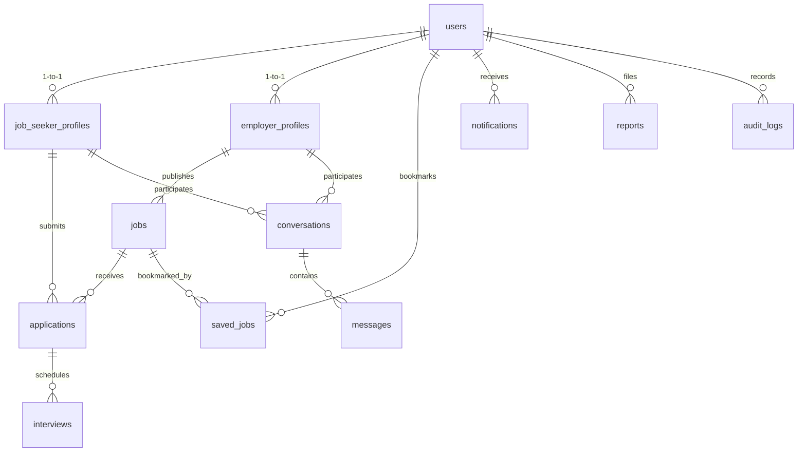

# X Power Program — Premier Employment & Job Matching Platform

> **Empowering Kenya's Workforce & Connecting Talent across East Africa.**

X Power Program is a full-stack, responsive digital employment platform built with Next.js (App Router), TypeScript, Tailwind CSS, and a relational database architecture. It features transparent skill-matching diagnostics, verified employer certification, in-platform recruiter messaging, and full statutory compliance with the **Kenya Data Protection Act, 2019**.

---

## 🚀 Key Features

### 1. Job Seekers
* **Profile & CV Management:** Create detailed profiles (Education, Location, Experience, Key Skills, Career Interests) and upload resumes in PDF format.
* **Transparent Skill-Match Engine:** 100-point compatibility score displaying exact technical skill overlaps, location alignment, and actionable career growth insights.
* **Job Discovery:** Full-text keyword search and multifaceted filtering by Kenyan counties (Nairobi, Mombasa, Kisumu, Nakuru, Eldoret, Remote), sector, employment type, and minimum monthly compensation in Kenyan Shillings (KES).
* **Application Tracker:** Visual 5-stage timeline progression (*Submitted* → *Under Review* → *Shortlisted* → *Interview* → *Hired* / *Rejected*) with recruiter notes.
* **Bookmarking:** Save vacancies for quick one-click review and application.
* **Real-time Notifications:** Automated alerts when recruiters review or update application statuses.

### 2. Employers & Recruiters
* **Company Profiles:** Showcase brand presence, industry, headquarters, description, website, and open positions.
* **Business Verification:** Submit Business Registration Service (BRS) Certificate of Incorporation or KRA PIN for administrative review to earn the official **Verified Employer** badge.
* **Vacancy Management:** Publish, edit, pause, and close job vacancies with structured compensation ranges (KES) and required skill tags.
* **Candidate Review Suite:** Inspect applicants, review PDF resumes, update candidate stages, add private review notes, and invite to interviews.
* **Interview Scheduling:** Coordinate virtual (Google Meet / Teams) or on-site interviews directly from the dashboard.
* **In-Platform Messaging:** Direct, secure two-way communication channel between recruiters and candidates.
* **Recruitment Analytics:** Track active listings, total candidate volume, interview pipelines, and listing impressions.

### 3. Trust, Safety & Administration
* **Moderation Console:** Protected administrator control center with high-level system KPIs.
* **Employer Verification Queue:** Review and approve or reject employer verification credentials.
* **Listing Moderation:** Suspend or remove fraudulent, duplicate, or fee-charging job postings.
* **User Reports Handling:** Dedicated trust and safety queue investigating suspicious activity.
* **Security Audit Trail:** Comprehensive event logs tracking all administrative interventions.

---

## 🛠️ Technology Stack

| Layer | Technology | Details |
|---|---|---|
| **Frontend** | Next.js 16 (App Router) + React 19 + TypeScript | High-performance, server-rendered and responsive |
| **Styling** | Tailwind CSS v4 | Curated color palette (Deep Navy `#0f172a`, Electric Blue `#0284c7`, Emerald `#10b981`) |
| **Database** | Native SQLite (`node:sqlite`) + PostgreSQL Schema | Zero-setup persistent storage locally + production `schema.sql` for PostgreSQL/Supabase |
| **Authentication** | JWT (via `jose`) + HTTP-Only Secure Cookies | Passwords hashed with `bcryptjs` (salt rounds: 10) |
| **Validation** | Zod | Robust schema validation for API inputs and forms |
| **Icons** | Lucide React | Modern, lightweight SVG icon set |

---

## 🧪 Instant Demo Test Accounts

The platform includes a persistent **Quick Demo Sandbox Bar** at the top of every page. You can switch between roles with a single click, or log in manually with the following credentials (password for all demo accounts is `Password123!`):

| Role | Name / Enterprise | Email | Pre-Loaded Data |
|---|---|---|---|
| **Job Seeker** | Amina Mwangi | `amina.mwangi@example.com` | Full profile, skills, attached CV, applications to Safaricom & Twiga |
| **Employer** | Safaricom PLC | `recruitment@safaricom.co.ke` | Verified badge, 2 active jobs (FinTech Engineer, Cloud DevOps), applicants |
| **Employer** | Twiga Foods | `careers@twigafoods.com` | Verified badge, AgriTech supply chain jobs, applicants |
| **Employer** | Equity Group Holdings | `careers@equitybank.co.ke` | Verification request pending in admin review queue |
| **Administrator** | Platform Admin | `admin@xpower.co.ke` | Full access to verification queue, reports, moderation & audit logs |

---

## 💻 Local Setup & Development

### Prerequisites
* **Node.js** v20+ or v24+ (Node 24 includes native SQLite support)
* **npm** v10+

### Step-by-Step Installation

1. **Clone or navigate to the repository directory:**
   ```bash
   cd "x power"
   ```

2. **Install dependencies:**
   ```bash
   npm install
   ```

3. **Environment Configuration:**
   Copy `.env.example` to `.env.local`:
   ```bash
   cp .env.example .env.local
   ```

4. **Launch the Development Server:**
   ```bash
   npm run dev
   ```
   Open [http://localhost:3000](http://localhost:3000) in your browser. The SQLite database will automatically initialize at `data/xpower.db` and seed realistic Kenyan tech and enterprise benchmark data on the first request!

5. **Verify Production Bundle:**
   ```bash
   npm run build
   npm run start
   ```

---

## 🗄️ Relational Database Architecture

The system relational model is defined with foreign key cascades, unique constraints, and indexes across 12 core tables:



### PostgreSQL / Supabase Production Migration
A complete migration script is provided in [`schema.sql`](file:///c:/Users/USER/Downloads/x%20power/schema.sql). To deploy on Supabase or AWS RDS PostgreSQL:
1. Open your Supabase project SQL Editor.
2. Paste the contents of `schema.sql` and run.
3. Configure `DATABASE_URL` in your deployment environment variables.

---

## 🔒 Security & Kenya Data Protection Act, 2019

* **Candidate CV Privacy:** Resumes are never exposed to public crawlers or unauthenticated guests. They are accessible solely by recruiters when a candidate explicitly applies for their vacancy.
* **Strict Anti-Fee Policy:** Under Kenyan labour law, charging job seekers recruitment or placement fees is strictly illegal. The platform provides a dedicated `/report-job` workflow to flag and suspend fraudulent listings.
* **Password Encryption:** Passwords are cryptographically salted and hashed with `bcryptjs`.
* **Tamper-Proof Sessions:** Signed JWTs stored in `httpOnly`, `sameSite: 'lax'` secure cookies prevent XSS and CSRF token theft.
